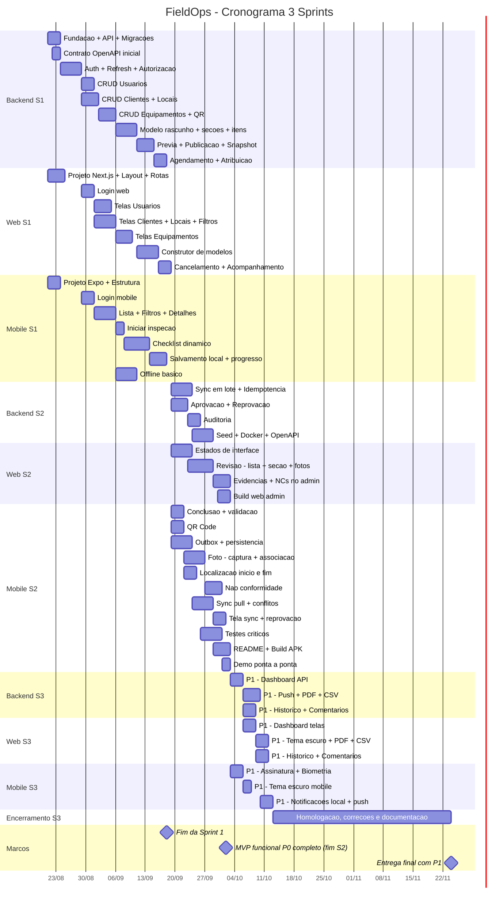

# Cronograma do projeto FieldOps

## Visão geral das sprints

| Sprint | Período | Foco |
|--------|---------|------|
| Sprint 1 | 21/08/2026 → 18/09/2026 | Estruturação inicial, telas de cadastro, construção dos modelos de inspeção e funcionamento básico no aplicativo |
| Sprint 2 | 19/09/2026 → 02/10/2026 | Sincronização offline, captura de evidências, fluxo de revisão e fechamento do MVP P0 |
| Sprint 3 | 03/10/2026 → 24/11/2026 (em andamento) | Funcionalidades de prioridade P1, estabilização da plataforma e entrega final |

---

## Sprint 1

> Realizada de 21/08/2026 a 18/09/2026

### Equipe inteira

| PBI | Título |
|-----|--------|
| TAP | Termo de Abertura do Projeto |

### Backend (Lucas e Marcela)

| PBI | Título |
|-----|--------|
| PBI-001 | Repositórios criados e convenções de código definidas |
| PBI-004 | API em Spring Boot ligada ao PostgreSQL com migrações |
| PBI-006 | Primeiro contrato OpenAPI com dados simulados para os front-ends |
| PBI-007 | Login por e-mail e senha na API |
| PBI-010 | Renovação automática de sessão por refresh token |
| PBI-012 | Controle de acesso por perfil na API |
| PBI-011 | CRUD de usuários feito pelo administrador |
| PBI-013 | CRUD de clientes |
| PBI-014 | CRUD de locais atrelados a clientes |
| PBI-015 | CRUD de equipamentos com QR Code individual |
| PBI-016 | QR Code exclusivo para cada equipamento |
| PBI-017 | Busca, filtros e paginação nas telas de cadastro |
| PBI-018 | Criação de modelo de inspeção em rascunho |
| PBI-019 | Criação e ordenação das seções do checklist |
| PBI-020 | Criação de itens com tipos de resposta |
| PBI-021 | Definição de itens obrigatórios e regras de evidência |
| PBI-022 | Validação e pré-visualização do checklist antes da publicação |
| PBI-023 | Publicação de uma versão imutável do modelo |
| PBI-024 | Snapshot dos itens no momento de criar a inspeção |
| PBI-025 | Agendamento de inspeção a partir de um modelo publicado |
| PBI-027 | Atribuição da inspeção a um técnico ativo |
| PBI-028 | Definição de prioridade, prazo e instruções da inspeção |
| PBI-029 | Cancelamento de inspeção com justificativa |

### Frontend Web (Andressa, Ian, Júlia e Carol)

| PBI | Título |
|-----|--------|
| PBI-001 | Repositórios e convenções definidos (participação) |
| PBI-003 | Projeto Next.js com layout, rotas protegidas e estrutura em módulos |
| PBI-005 | Lint, checagem de tipos e fluxo de pull request |
| PBI-009 | Login e sessão na interface web |
| PBI-011 | CRUD de usuários pelo administrador (telas) |
| PBI-013 | CRUD de clientes (telas) |
| PBI-014 | CRUD de locais atrelados a clientes (telas) |
| PBI-015 | CRUD de equipamentos com QR Code individual (telas) |
| PBI-017 | Busca, filtros e paginação nos cadastros (telas) |
| PBI-018 | Criação de modelo de inspeção em rascunho (telas) |
| PBI-019 | Criação e ordenação das seções do checklist (telas) |
| PBI-020 | Criação de itens com tipos de resposta (telas) |
| PBI-022 | Pré-visualização do checklist antes da publicação |
| PBI-026 | Seleção encadeada de cliente → local → equipamento |
| PBI-029 | Cancelamento de inspeção com justificativa (tela) |
| PBI-030 | Acompanhamento das inspeções em listagem com filtros |

### Mobile (Rodrigo, Natália e Cutiur)

| PBI | Título |
|-----|--------|
| PBI-001 | Repositórios e convenções definidos (participação) |
| PBI-002 | Projeto Expo com TypeScript e estrutura organizada por features |
| PBI-008 | Login e sessão no aplicativo mobile |
| PBI-031 | Download e visualização das inspeções recebidas |
| PBI-032 | Filtro de inspeções por estado, data e prioridade |
| PBI-033 | Detalhamento da inspeção no mobile |
| PBI-034 | Início da inspeção com registro de horário |
| PBI-035 | Checklist dinâmico montado a partir do snapshot |
| PBI-036 | Componentes de resposta para cada tipo de item |
| PBI-037 | Salvamento de cada resposta no banco local (SQLite) |
| PBI-038 | Visualização do progresso e dos itens pendentes |
| PBI-039 | Registro de observações nos itens |
| PBI-048 | Acesso offline às inspeções já baixadas |

---

## Sprint 2

> Realizada de 19/09/2026 a 02/10/2026

### Backend (Lucas e Marcela)

| PBI | Título |
|-----|--------|
| PBI-051 | Envio em lote que respeita as dependências |
| PBI-052 | Idempotência para evitar duplicidade no reenvio |
| PBI-060 | Aprovação da inspeção |
| PBI-061 | Reprovação da inspeção com motivo obrigatório |
| PBI-063 | Auditoria das mudanças de estado |
| PBI-066 | Dados de demonstração reproduzíveis (seed) |
| PBI-070 | API empacotada em contêiner Docker para demonstração |
| PBI-071 | Contrato OpenAPI completo e diagramas |

### Frontend Web (Andressa, Ian, Júlia e Carol)

| PBI | Título |
|-----|--------|
| PBI-047 | Visualização de evidências e não conformidades no admin |
| PBI-056 | Listagem das inspeções aguardando revisão |
| PBI-057 | Revisão das respostas por seção e por item |
| PBI-058 | Lightbox de fotografias durante a revisão |
| PBI-059 | Início formal da revisão |
| PBI-064 | Estados de carregamento, vazio, erro e offline |
| PBI-069 | Build e publicação do painel web admin |

### Mobile (Rodrigo, Natália e Cutiur)

| PBI | Título |
|-----|--------|
| PBI-040 | Conclusão com validação dos itens obrigatórios |
| PBI-041 | Leitura de QR Code para confirmar o equipamento |
| PBI-042 | Captura de fotografia com pré-visualização |
| PBI-043 | Associação da fotografia ao item correto |
| PBI-044 | Foto marcada como pendente quando o upload falha |
| PBI-045 | Registro de localização no início e na conclusão |
| PBI-046 | Registro de não conformidade com criticidade |
| PBI-049 | Persistência das respostas após fechar o aplicativo |
| PBI-050 | Registro de alterações na outbox persistente |
| PBI-053 | Pull de alterações usando cursor de sincronização |
| PBI-054 | Tela de status da sincronização |
| PBI-055 | Detecção de conflito de versão |
| PBI-062 | Técnico recebe a inspeção reprovada para correção |
| PBI-065 | Testes automatizados dos fluxos críticos |
| PBI-067 | READMEs com instruções de execução |
| PBI-068 | Build Android (APK) para demonstração |
| PBI-072 | Demonstração de ponta a ponta |

---

## Sprint 3

> De 03/10/2026 a 24/11/2026 (sprint em andamento, encerra na entrega final)

### Backend (Lucas e Marcela)

| PBI | Título |
|-----|--------|
| PBI-073 | *P1:* Dashboard com indicadores por estado e criticidade (API) |
| PBI-075 | *P1:* Notificações push — integração no servidor |
| PBI-077 | *P1:* Relatório PDF básico |
| PBI-078 | *P1:* Histórico detalhado das respostas |
| PBI-079 | *P1:* Comentários de revisão por item |
| PBI-082 | *P1:* Exportação em CSV |

### Frontend Web (Andressa, Ian, Júlia e Carol)

| PBI | Título |
|-----|--------|
| PBI-073 | *P1:* Dashboard com indicadores (telas) |
| PBI-077 | *P1:* Relatório PDF básico (visualização e download) |
| PBI-078 | *P1:* Histórico detalhado das respostas (telas) |
| PBI-079 | *P1:* Comentários de revisão por item (telas) |
| PBI-081 | *P1:* Tema escuro |
| PBI-082 | *P1:* Exportação em CSV (botão e download) |

### Mobile (Rodrigo, Natália e Cutiur)

| PBI | Título |
|-----|--------|
| PBI-074 | *P1:* Notificações locais de prazo |
| PBI-075 | *P1:* Notificações push de nova atribuição |
| PBI-076 | *P1:* Assinatura desenhada no dispositivo |
| PBI-080 | *P1:* Biometria para reabrir a sessão local |
| PBI-081 | *P1:* Tema escuro (mobile) |

### Equipe inteira

| Atividade | Título |
|-----|--------|
| — | Homologação, ajustes e documentação final |
| — | Entrega final do projeto (24/11/2026) |

---

## Diagrama de Gantt

