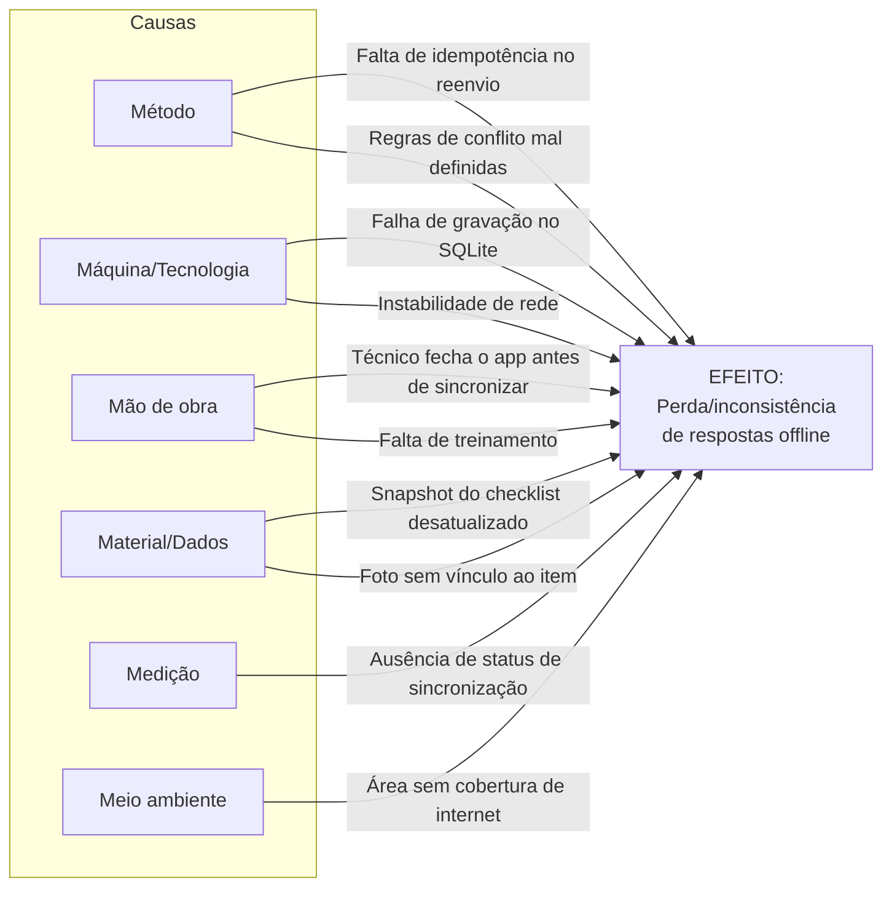
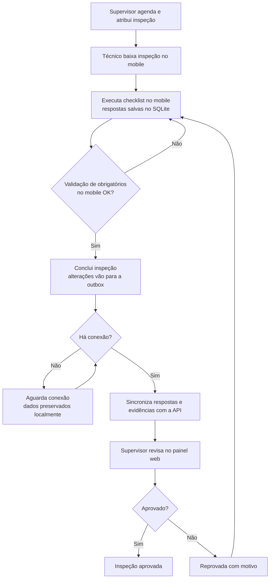
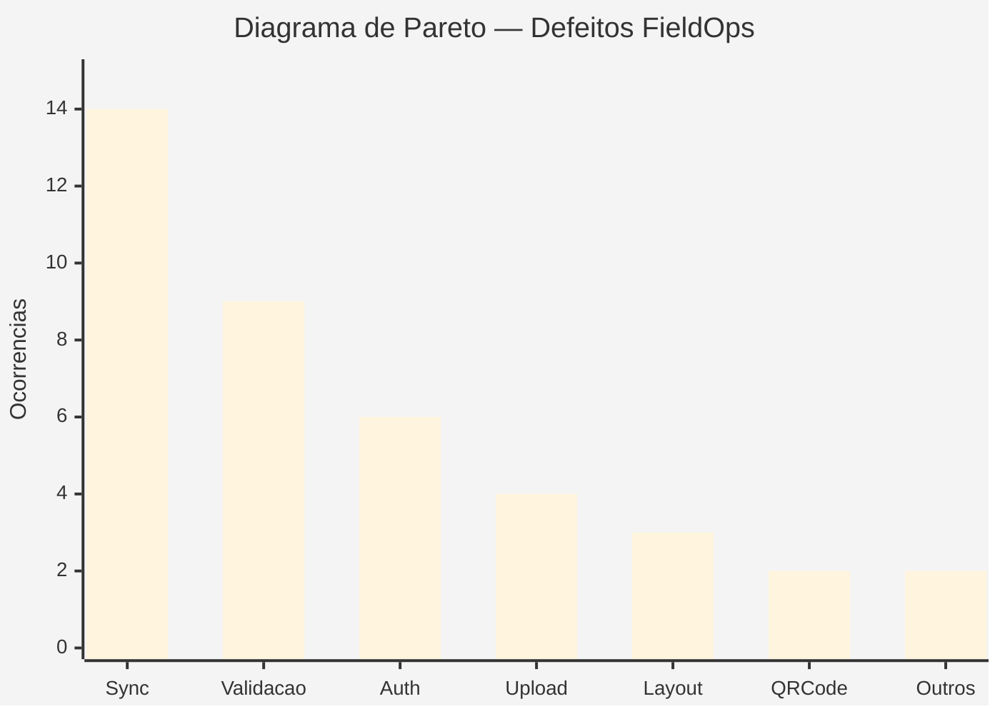
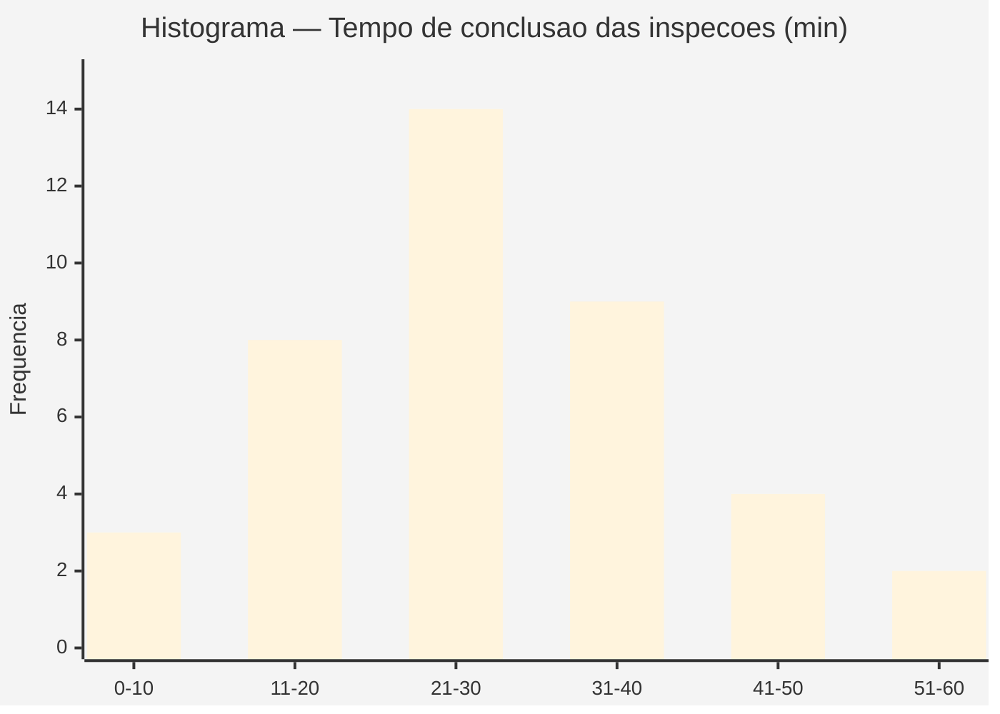
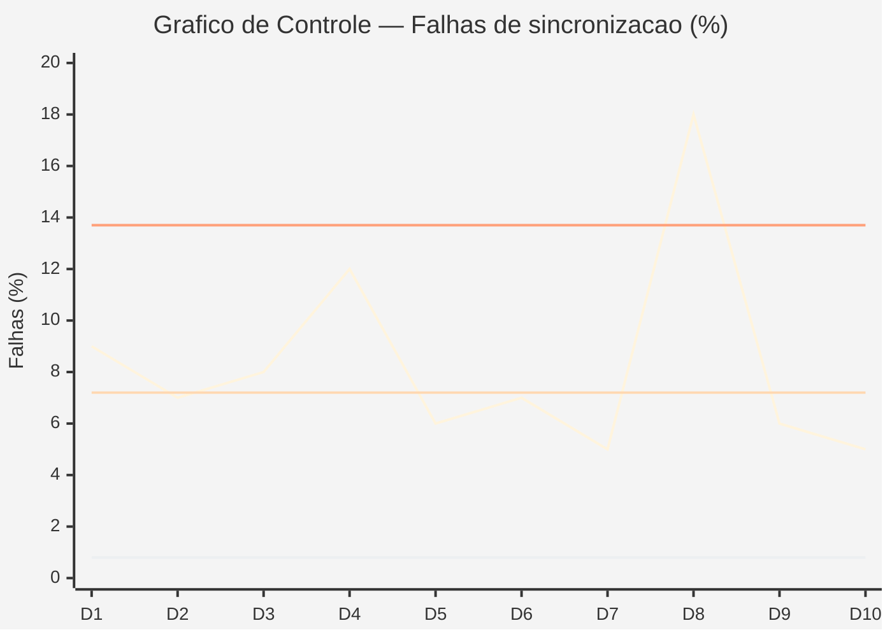
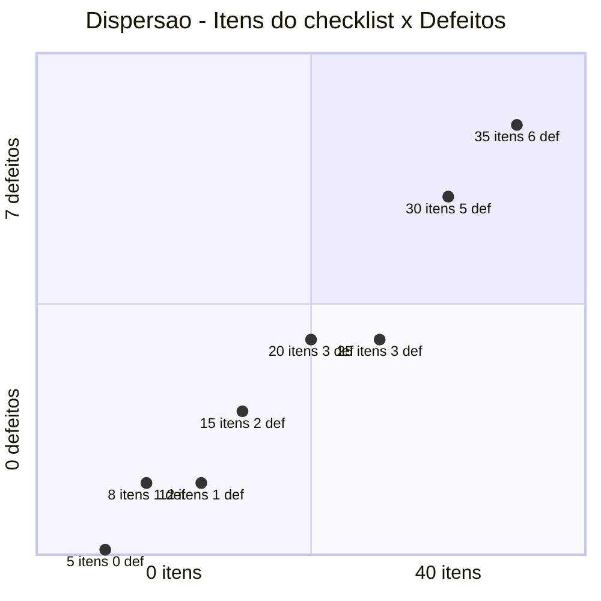

# Análise de Qualidade — Projeto FieldOps

> **Disciplina:** Gestão de Projetos — 4º semestre ADS
> **Professor:** Me. Deivison S. Takatu
> **Aula 05:** Custos e Qualidade — Atividade de Qualidade
> **Projeto:** FieldOps — Plataforma de Inspeção em Campo
> **Equipe:** 404 Not Found
> **Data:** 04/09/2026

---

## 1. Objetivo

Neste documento fazemos uma avaliação da qualidade do Projeto FieldOps valendo-nos das **Sete Ferramentas Básicas da Qualidade**. A análise se ancora no processo de **Gerenciamento da Qualidade do Projeto** descrito no PMBOK (área de conhecimento 8), que envolve planejar, garantir e controlar a qualidade ao longo do ciclo de vida do projeto.

Para sustentar o estudo, combinamos dois conjuntos de informação: de um lado, os artefatos já produzidos pelo projeto ([TAP](../Aula%2002%20-%2014.08.2026/Modelo%20-%204.1%20Termo%20de%20Abertura%20de%20Projeto.pdf), [EAP](../Aula%2003%20-%2021.08.2026/aula03-EAP.pdf), [Cronograma](../Aula%2004%20-%2028.08.2026/cronograma.md) e o Backlog); de outro, dados simulados de defeitos encontrados em testes e de inspeções de acompanhamento. O propósito é descobrir as causas raiz dos problemas, decidir onde atacar primeiro e acompanhar o desempenho ao longo do tempo.

### O que significa qualidade para o FieldOps
- **Satisfazer a necessidade do cliente:** entregar o fluxo completo da inspeção exatamente como foi especificado.
- **Prevenir em vez de corrigir:** evitar que o defeito nasça, como no caso da perda de respostas coletadas offline.
- **Cultivar a melhoria contínua:** transformar cada sprint em aprendizado para refinar o processo.
- **Decidir com base em dados:** usar indicadores para detectar desvios e reagir a tempo.

---

## 2. As Sete Ferramentas aplicadas ao FieldOps

### 2.1 Diagrama de Causa e Efeito (Ishikawa)

**Problema escolhido:** *"Perda ou inconsistência de respostas de inspeção durante o uso offline/sincronização"* — um dos riscos mais sensíveis do projeto.

**Leitura do diagrama:** as causas de maior peso aparecem em **Método** — idempotência no reenvio e regras de conflito — e em **Máquina/Tecnologia** — a camada de persistência local (SQLite) e a rede. Coincidem, não por acaso, com os PBIs 050 a 055 do backlog, que já tratam justamente dessas frentes.

---

### 2.2 Fluxograma

**Processo representado:** o caminho completo de uma inspeção, desde o agendamento pelo supervisor até a aprovação (ou reprovação) final.

**Leitura do fluxograma:** ficam visíveis dois pontos em que a qualidade é controlada. O primeiro é a **validação de obrigatórios** feita no próprio celular, antes de a inspeção ser concluída e enviada (PBI-040); o segundo é a **revisão do supervisor** no painel web. Ambos funcionam como barreiras que impedem o defeito de avançar até a aprovação. Como a validação roda no dispositivo, ela continua atuando mesmo sem conexão.

---

### 2.3 Folha de Verificação (Check Sheet)

**Como os dados foram coletados:** contagem dos defeitos anotados nos testes da Sprint 1 e no início da Sprint 2 (números simulados para fins de análise).

| Categoria de defeito | Ocorrências | Frequência |
|---|---|---:|
| Falha de sincronização offline | ▍▍▍▍▍▍▍▍▍▍▍▍▍▍ | 14 |
| Validação de formulário/checklist | ▍▍▍▍▍▍▍▍▍ | 9 |
| Autenticação / sessão (token) | ▍▍▍▍▍▍ | 6 |
| Upload de evidências (foto) | ▍▍▍ | 4 |
| Layout / responsividade (web) | ▍▍▍ | 3 |
| Leitura de QR Code | ▍▍ | 2 |
| Outros | ▍▍ | 2 |
| **Total** | | **40** |

**Leitura:** a folha de verificação organiza a coleta e revela que **falhas de sincronização** e problemas de **validação** respondem pela maior fatia dos defeitos registrados.

---

### 2.4 Diagrama de Pareto

**Princípio aplicado:** a regra 80/20, para isolar as poucas categorias que concentram a maior parte dos defeitos.

| Categoria | Ocorrências | % | % Acumulado |
|---|---:|---:|---:|
| Falha de sincronização offline | 14 | 35,0% | 35,0% |
| Validação de formulário/checklist | 9 | 22,5% | 57,5% |
| Autenticação / sessão | 6 | 15,0% | 72,5% |
| Upload de evidências | 4 | 10,0% | 82,5% |
| Layout / responsividade | 3 | 7,5% | 90,0% |
| Leitura de QR Code | 2 | 5,0% | 95,0% |
| Outros | 2 | 5,0% | 100,0% |

**Leitura:** apenas três categorias — **sincronização, validação e autenticação** — somam **72,5%** dos defeitos. Dirigir os esforços de correção e de teste para elas produz o maior retorno em qualidade.

---

### 2.5 Histograma

**O que foi medido:** o tempo de conclusão (em minutos) de 40 inspeções de teste.

| Faixa (min) | Frequência |
|---|---:|
| 0–10 | 3 |
| 11–20 | 8 |
| 21–30 | 14 |
| 31–40 | 9 |
| 41–50 | 4 |
| 51–60 | 2 |

**Leitura:** a distribuição se aproxima de uma curva normal, com pico na faixa de **21–30 minutos** por inspeção. A cauda acima de 40 minutos aponta casos provavelmente ligados a muitas não conformidades ou a problemas de conexão, que valem uma investigação mais detalhada.

---

### 2.6 Gráfico de Controle

**O que foi monitorado:** a porcentagem diária de sincronizações com falha ao longo de 10 dias de testes.

| Dia | Falhas de sync (%) |
|---|---:|
| 1 | 9 |
| 2 | 7 |
| 3 | 8 |
| 4 | 12 |
| 5 | 6 |
| 6 | 7 |
| 7 | 5 |
| 8 | 18 |
| 9 | 6 |
| 10 | 5 |

**Cálculo dos limites (carta de valores individuais e amplitude móvel — I-MR):** os limites foram calculados sobre os 9 dias sem causa especial suspeita; o Dia 8 ficou de fora do cálculo, prática usual para não inflar os limites com o próprio ponto sob investigação.

- **Média (linha central):** 65 ÷ 9 = **7,2%**
- **Amplitude móvel média (MR̄):** média das diferenças entre dias consecutivos (sem os pares que envolvem o Dia 8) = 17 ÷ 7 = **2,43**
- **Limite Superior de Controle (LSC):** 7,2 + 2,66 × 2,43 = **13,7%**
- **Limite Inferior de Controle (LIC):** 7,2 − 2,66 × 2,43 = **0,8%**

**Leitura:** o **Dia 8 (18%)** rompe o LSC de 13,7%, sinalizando um ponto **fora de controle**, associado a uma causa especial — provavelmente a instabilidade de rede ou de deploy daquele dia. Os demais pontos, entre eles o Dia 4 (12%), ficam dentro dos limites, o que caracteriza variação comum e mostra um processo em sua maior parte estável.

---

### 2.7 Diagrama de Dispersão

**Correlação investigada:** a relação entre a **quantidade de itens do checklist** e o **número de defeitos** relatados por inspeção.

| Itens no checklist | Defeitos |
|---:|---:|
| 5 | 0 |
| 8 | 1 |
| 12 | 1 |
| 15 | 2 |
| 20 | 3 |
| 25 | 3 |
| 30 | 5 |
| 35 | 6 |

No gráfico abaixo, cada ponto representa uma inspeção posicionada pelos seus valores reais: o eixo X traz os itens do checklist (de 0 a 40) e o eixo Y, os defeitos (de 0 a 7). As coordenadas de cada ponto correspondem ao valor dividido pelo máximo do eixo (exemplo: 20 itens e 3 defeitos resultam em x = 20/40 = 0,50 e y = 3/7 = 0,43).

**Coeficiente de correlação de Pearson:** r ≈ **0,98** (correlação positiva forte).

**Leitura:** os pontos sobem da esquerda para a direita e ficam próximos de uma reta, configurando uma **correlação positiva** — quanto mais itens no checklist, maior tende a ser o número de defeitos. Isso justifica reforçar testes e validações nos modelos de inspeção mais extensos, com muitos itens e seções.

---

## 3. Conclusões

1. **Ponto crítico único:** as ferramentas apontam para a mesma direção — a **sincronização offline**, que lidera a folha de verificação, encabeça o Pareto e produz o único ponto fora de controle.
2. **Priorização pelo Pareto:** atacar sincronização, validação e autenticação resolve cerca de **72,5%** dos defeitos, sendo as ações de melhor retorno.
3. **Prevenção na origem:** o Ishikawa e o fluxograma mostram que reforçar a idempotência, as regras de conflito e a barreira de validação de obrigatórios evita que o defeito chegue à revisão.
4. **Estabilidade do processo:** à exceção da causa especial do Dia 8, o processo se mantém dentro dos limites de controle — o esforço deve ir para eliminar causas especiais.
5. **Complexidade x defeitos:** a dispersão evidencia que modelos de inspeção com muitos itens exigem atenção redobrada nos testes.

### Ações recomendadas
- Tratar com prioridade os PBIs de **sincronização e idempotência**, com testes automatizados dedicados a eles.
- Incorporar a **folha de verificação** como rotina de coleta em todas as sprints.
- Monitorar semanalmente o **gráfico de controle** de falhas de sincronização.
- Criar testes de regressão específicos para checklists com **mais de 25 itens**.
