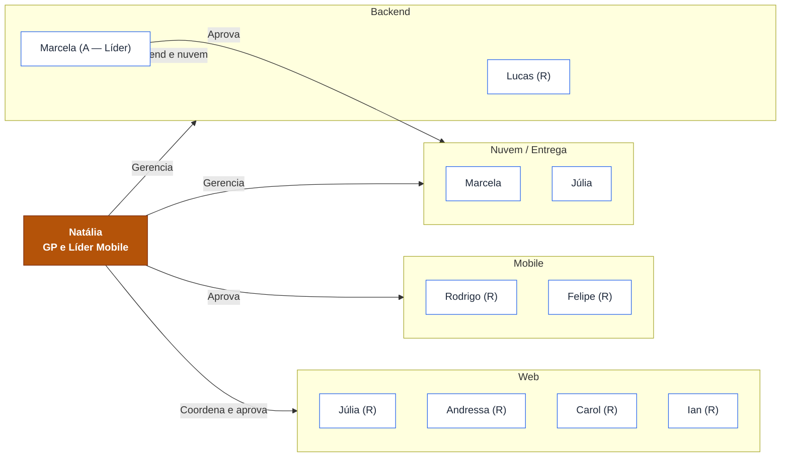

# 🧭 Matriz RACI — Projeto FieldOps

> **Projeto:** FieldOps — Plataforma de Inspeção em Campo
> **Documento:** Matriz de Responsabilidades (RACI)
> **Base:** 48 PBIs (cards) distribuídos por **todas as áreas** do projeto — o mínimo exigido era 40. Detalhes no [cronograma](../Aula%2004%20-%2028.08.2026/cronograma.md) da Aula 04 e na [EAP](../Aula%2003%20-%2021.08.2026/aula03-EAP.pdf) da Aula 03.
> **Versão:** 1.0

---

## 1. Objetivo

A Matriz RACI funciona como uma matriz de responsabilidades (MR): ela indica quais recursos do projeto ficam vinculados a cada pacote de trabalho. Em cada atividade (card/PBI) são definidos os seguintes papéis:

| Sigla | Papel | Significado |
|---|---|---|
| **R** | **Responsável** | Coloca a mão na massa e executa a atividade. |
| **A** | **Aprovador** (Accountable) | Responde pelo resultado e o aprova. Cada atividade tem um único A. |
| **C** | **Consultado** | Contribui com conhecimento relevante; a comunicação é bidirecional. |
| **I** | **Informado** | Recebe atualizações sobre andamento e resultado, em comunicação unidirecional. |

---

## 2. Legenda de responsáveis

| Sigla | Integrante | Papel |
|---|---|---|
| **NAT** | Natália | Gerente de Projeto e Líder Mobile |
| **MAR** | Marcela | Líder Backend e Nuvem |
| **LUC** | Lucas | Dev Backend |
| **JUL** | Júlia | Líder Web e Nuvem |
| **AND** | Andressa | Dev Web |
| **CAR** | Carol | Dev Web |
| **IAN** | Ian | Dev Web |
| **ROD** | Rodrigo | Dev Mobile |
| **FEL** | Felipe (Cutiur) | Dev Mobile |

---

## 3. Matriz RACI — 40 cards cobrindo todas as áreas

> Legenda: **R** — Responsável · **A** — Aprovador · **C** — Consultado · **I** — Informado

### 3.1 Gestão e Planejamento

| # | Card / Atividade | NAT | LUC | MAR | JUL | AND | CAR | IAN | ROD | FEL |
|---|---|:--:|:--:|:--:|:--:|:--:|:--:|:--:|:--:|:--:|
| TAP | Termo de Abertura de Projeto | A/R | C | C | C | I | I | I | I | I |
| PBI-001 | Repositórios e padrões de projeto definidos | A | R | C | R | C | C | C | C | C |

### 3.2 Backend (API REST)

| # | Card / Atividade | NAT | LUC | MAR | JUL | AND | CAR | IAN | ROD | FEL |
|---|---|:--:|:--:|:--:|:--:|:--:|:--:|:--:|:--:|:--:|
| PBI-004 | API em Spring Boot integrada ao PostgreSQL, com migrações | I | R | A | C | I | I | I | I | I |
| PBI-006 | Contrato OpenAPI inicial e massa de dados simulada | I | R | A | C | C | C | C | C | C |
| PBI-007 | Autenticação na API por e-mail e senha | I | R | A | C | I | I | I | I | I |
| PBI-010 | Renovação automática de sessão via refresh token | I | R | A | I | I | I | I | C | C |
| PBI-012 | Autorização por perfil de acesso na API | I | R | A | C | I | I | I | I | I |
| PBI-011 | CRUD de usuários realizado pelo administrador | I | R | A | C | R | I | I | I | I |
| PBI-013 | CRUD de clientes | I | R | A | C | R | I | I | I | I |
| PBI-015 | CRUD de equipamentos com QR Code exclusivo | I | R | A | C | I | R | I | I | I |
| PBI-023 | Publicação da versão imutável do modelo | I | R | A | C | I | I | C | I | I |
| PBI-024 | Snapshot dos itens na criação da inspeção | I | R | A | I | I | I | I | C | C |
| PBI-025 | Agendamento de inspeção a partir de modelo já publicado | I | R | A | C | I | I | R | I | I |
| PBI-051 | Envio em lote que respeita as dependências | I | R | A | I | I | I | I | C | C |
| PBI-052 | Idempotência para evitar duplicidade no reenvio | I | R | A | I | I | I | I | C | C |
| PBI-060 | Aprovação de inspeção | I | R | A | C | R | I | I | I | I |
| PBI-061 | Reprovação de inspeção com motivo obrigatório | I | R | A | C | R | I | I | C | I |
| PBI-063 | Auditoria das mudanças de estado | I | R | A | I | I | I | I | I | I |
| PBI-071 | OpenAPI completo e respectivos diagramas | I | R | A | C | C | C | C | C | C |

### 3.3 Interface Administrativa Web

| # | Card / Atividade | NAT | LUC | MAR | JUL | AND | CAR | IAN | ROD | FEL |
|---|---|:--:|:--:|:--:|:--:|:--:|:--:|:--:|:--:|:--:|
| PBI-003 | Estrutura Next.js com layout e rotas protegidas | A | I | I | R | R | C | C | I | I |
| PBI-005 | Lint, checagem de tipos e fluxo de PR | A | C | C | R | C | C | C | I | I |
| PBI-009 | Autenticação e sessão na interface web | A | C | I | R | R | C | I | I | I |
| PBI-017 | Busca, filtros e paginação nas telas de cadastro | A | C | I | R | C | R | C | I | I |
| PBI-022 | Prévia do checklist antes da publicação | A | C | I | R | R | C | C | I | I |
| PBI-026 | Seleção encadeada de cliente, local e equipamento | A | C | I | R | C | R | C | I | I |
| PBI-030 | Acompanhamento de inspeções em listagem com filtros | A | C | I | R | C | C | R | I | I |
| PBI-047 | Visualização de evidências e não conformidades no admin | A | C | I | R | R | C | C | C | I |
| PBI-056 | Listagem das inspeções aguardando revisão | A | C | I | R | C | R | C | I | I |
| PBI-057 | Revisão das respostas por seção e item | A | C | I | R | R | C | C | I | I |
| PBI-058 | Lightbox de fotos durante a revisão | A | I | I | R | C | C | R | I | I |
| PBI-069 | Build e publicação do painel administrativo web | A | C | C | R | C | C | C | I | I |

### 3.4 Aplicativo Mobile

| # | Card / Atividade | NAT | LUC | MAR | JUL | AND | CAR | IAN | ROD | FEL |
|---|---|:--:|:--:|:--:|:--:|:--:|:--:|:--:|:--:|:--:|
| PBI-002 | Projeto Expo em TypeScript organizado por features | A/R | I | I | C | I | I | I | R | C |
| PBI-008 | Autenticação e sessão no app mobile | A | C | I | I | I | I | I | R | C |
| PBI-031 | Download e visualização das inspeções atribuídas ao técnico | A | C | I | I | I | I | I | R | R |
| PBI-033 | Detalhes da inspeção no app mobile | A | C | I | I | I | I | I | R | C |
| PBI-034 | Início da inspeção com registro de horário | A | C | I | I | I | I | I | R | C |
| PBI-035 | Checklist dinâmico gerado a partir do snapshot | A/R | C | I | I | I | I | I | R | C |
| PBI-042 | Captura de fotografia e visualização da prévia | A | I | I | I | I | I | I | R | R |
| PBI-045 | Registro de localização no início e na conclusão | A | C | I | I | I | I | I | R | C |
| PBI-050 | Registro de alterações na outbox persistente | A | C | I | I | I | I | I | R | R |
| PBI-054 | Tela de status da sincronização | A/R | C | I | I | I | I | I | C | R |
| PBI-062 | Técnico recebe inspeção reprovada para corrigir | A | C | I | I | I | I | I | R | C |
| PBI-068 | Build Android (APK) para a demonstração | A/R | I | C | C | I | I | I | R | C |

### 3.5 Nuvem, Qualidade e Entrega

| # | Card / Atividade | NAT | LUC | MAR | JUL | AND | CAR | IAN | ROD | FEL |
|---|---|:--:|:--:|:--:|:--:|:--:|:--:|:--:|:--:|:--:|
| PBI-066 | Dados de demonstração reproduzíveis (seed) | I | R | A | C | I | I | I | C | I |
| PBI-070 | API em contêiner Docker para a demonstração | I | C | A/R | R | I | I | I | I | I |
| PBI-065 | Testes automatizados dos fluxos críticos | A | R | C | R | C | C | C | R | C |
| PBI-067 | READMEs com as instruções de execução | A/R | C | C | C | C | C | C | C | C |
| PBI-072 | Demonstração de ponta a ponta (MVP) | A/R | C | C | C | C | C | C | C | C |

---

## 4. Diagrama de responsabilidades por área (Mermaid)

Visão complementar que resume quem **executa (R)** e quem **aprova (A)** as grandes frentes do projeto.

---

## 5. Observações sobre a atribuição

- **Um único Aprovador (A) por atividade:** a aprovação fica com o **líder da área** dona do card — **Marcela** responde pelos cards de Backend e Nuvem, **Júlia** pelos de Web e **Natália** (Gerente de Projeto e Líder Mobile) pelos de Mobile e pelos de Gestão/Entrega. Quando o líder executa o próprio card, ele acumula A e R.
- **Responsável (R):** o(s) desenvolvedor(es) da área que efetivamente executa(m) o card.
- **Consultado (C):** em geral, a área que entrega o contrato ou a dependência (ex.: Backend é consultado por Web e Mobile nos cards que consomem a API).
- **Informado (I):** as demais áreas que só precisam conhecer o resultado, sem atuar diretamente.
- Cards que atravessam frentes (como **PBI-060 Aprovar inspeção** e **PBI-011 CRUD de usuários**) têm **R** tanto no Backend (endpoint) quanto no Web (tela), o que reflete o trabalho conjunto entre as equipes.
