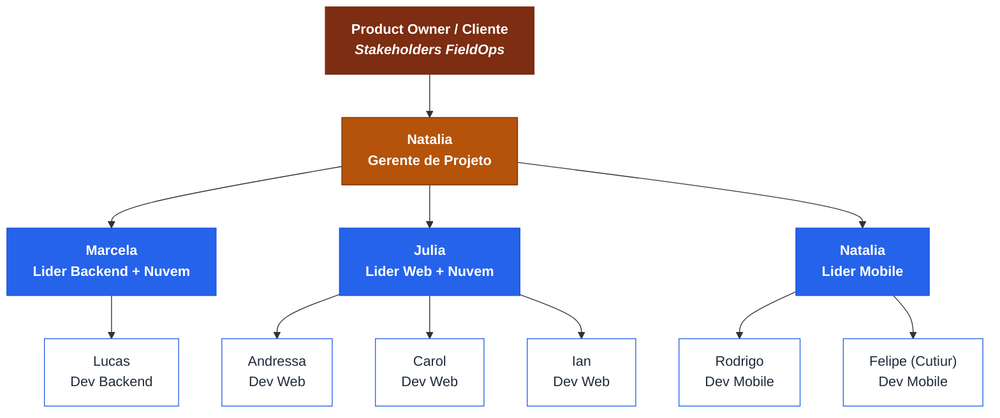

# 🏢 Organograma — Projeto FieldOps

> **Projeto:** FieldOps — Plataforma de Inspeção em Campo
> **Documento:** Organograma (Estrutura Hierárquica e Responsáveis)
> **Disciplina:** Gestão de Projetos — RH e Comunicações
> **Versão:** 1.0

---

## 1. Objetivo

A finalidade deste documento é apresentar, de forma visual e organizada de cima para baixo, a **estrutura hierárquica do projeto FieldOps** e quem são os **responsáveis por cada nível**. O organograma segue a representação tradicional, indicando as posições ocupadas, os papéis de cada integrante e como ocorrem as relações de subordinação entre as áreas de Backend, Web, Mobile e Nuvem/Infraestrutura.

A composição apresentada aqui está em conformidade com o que foi registrado no [Termo de Abertura do Projeto](../Aula%2002%20-%2014.08.2026/Modelo%20-%204.1%20Termo%20de%20Abertura%20de%20Projeto.pdf) (Aula 02) e na [EAP](../Aula%2003%20-%2021.08.2026/aula03-EAP.pdf) (Aula 03), documentos em que a **Natália** aparece como Gerente do Projeto.

---

## 2. Equipe e papéis

| Integrante | GitHub | Papel no projeto | Área |
|---|---|---|---|
| **Natália** | [@NataliaNogueira1](https://github.com/NataliaNogueira1) | Gerente de Projeto + Desenvolvedora Mobile | Gestão / Mobile |
| **Marcela** | [@MarcelaMulato](https://github.com/MarcelaMulato) | Líder de Backend + Nuvem | Backend / Nuvem |
| **Lucas** | [@lucasmiguelleite](https://github.com/lucasmiguelleite) | Desenvolvedor Backend | Backend |
| **Júlia** | [@JujubsPaes](https://github.com/JujubsPaes) | Desenvolvedora Web + Nuvem | Web / Nuvem |
| **Andressa** | [@DreBartolomeu](https://github.com/DreBartolomeu) | Desenvolvedora Web | Web |
| **Carol** | [@almeida-carol](https://github.com/almeida-carol) | Desenvolvedora Web | Web |
| **Ian** | [@IanLucasss](https://github.com/IanLucasss) | Desenvolvedor Web | Web |
| **Rodrigo** | [@Rodrigof981](https://github.com/Rodrigof981) | Desenvolvedor Mobile | Mobile |
| **Felipe (Cutiur)** | [@Cutiur](https://github.com/Cutiur) | Desenvolvedor Mobile | Mobile |

> **Observação:** por se tratar de um projeto acadêmico com uma equipe enxuta, alguns membros acabam acumulando mais de uma função. É o caso da Natália, que concilia a gerência do projeto com o desenvolvimento Mobile, e também da Marcela e da Júlia, que somam a Nuvem às suas frentes de desenvolvimento.

---

## 3. Organograma (Mermaid)



---

## 4. Descrição das responsabilidades por nível

### 4.1 Product Owner / Cliente (Stakeholders)
Corresponde às partes interessadas do FieldOps. Cabe a esse nível definir a visão do produto e as prioridades de negócio, além de validar as entregas de valor — o que inclui a aprovação final do MVP.

### 4.2 Gerente de Projeto — Natália
Fica a seu cargo a **gestão e o planejamento** do projeto (EAP, backlog e cronograma), a coordenação entre as três frentes de desenvolvimento e o contato com os stakeholders. Ela também acompanha o desempenho da equipe, remove impedimentos e conduz as cerimônias do projeto.

### 4.3 Líderes de área
- **Marcela — Líder Backend + Nuvem:** conduz a API REST (Java + Spring Boot), a autenticação, as regras de negócio, a persistência e a sincronização, e ainda dá suporte à infraestrutura/nuvem (ambientes, banco e pipeline). É a **aprovadora** das entregas de backend.
- **Júlia — Líder Web + Nuvem:** conduz a interface administrativa (Next.js) e também apoia a infraestrutura/nuvem.
- **Natália — Líder Mobile:** conduz o aplicativo (Expo/React Native), acumulando essa função com a gerência do projeto.

### 4.4 Desenvolvedores
- **Backend:** Lucas.
- **Web:** Andressa, Carol e Ian.
- **Mobile:** Rodrigo e Felipe (Cutiur).

---

## 5. Estrutura hierárquica resumida (texto)

```text
Product Owner / Cliente (Stakeholders)
└── Natália — Gerente de Projeto
    ├── Backend
    │   ├── Marcela (Líder Backend + Nuvem)
    │   └── Lucas (Dev Backend)
    ├── Web
    │   ├── Júlia (Líder Web + Nuvem)
    │   ├── Andressa (Dev Web)
    │   ├── Carol (Dev Web)
    │   └── Ian (Dev Web)
    └── Mobile
        ├── Natália (Líder Mobile)
        ├── Rodrigo (Dev Mobile)
        └── Felipe / Cutiur (Dev Mobile)
```
