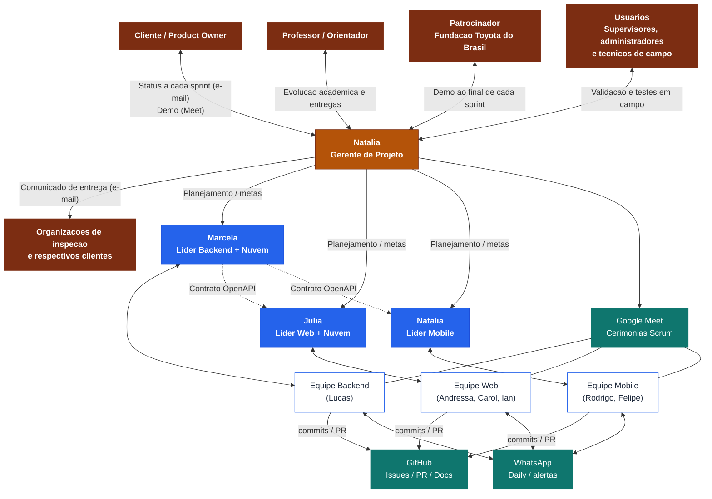

# 📣 Plano de Comunicação — Projeto FieldOps

> **Projeto:** FieldOps — Plataforma de Inspeção em Campo
> **Documento:** Plano de Gerenciamento das Comunicações
> **Disciplina:** Gestão de Projetos — RH e Comunicações
> **Versão:** 1.0

---

## 1. Objetivo

Este documento estabelece como devem fluir as comunicações do projeto FieldOps, tomando como ponto de partida as necessidades de informação de cada parte interessada. Nele ficam definidos **o que** se comunica, **com qual periodicidade**, por **qual canal**, **para quem**, sob **a responsabilidade de quem**, em **qual formato** e **em que momento** a comunicação acontece.

---

## 2. Partes interessadas (stakeholders)

| Parte interessada | Interesse principal | Canal preferencial |
|---|---|---|
| Patrocinador — Fundação Toyota do Brasil | Retorno sobre o investimento e os resultados alcançados | Apresentação ao término de cada sprint (presencial ou Meet) |
| Cliente / Product Owner | Valor entregue e progresso do MVP | Reunião e e-mail |
| Organizações responsáveis pela execução das inspeções | Incorporação da plataforma à rotina de inspeção | Reunião e e-mail |
| Clientes atendidos pelas organizações | Resultados de inspeção confiáveis e rápidos | E-mail, via organizações |
| Supervisores de inspeção | Planejar, acompanhar e revisar as inspeções pelo painel web | Sessões de validação e homologação |
| Administradores do sistema | Cadastro de usuários e configuração de modelos | Sessões de validação e homologação |
| Técnicos de campo | App simples, confiável e que funcione offline | Testes em campo e demonstrações |
| Gerente de Projeto (Natália) | Progresso geral, riscos e impedimentos | Todos os canais |
| Líderes de área (Marcela, Júlia, Natália) | Coordenação técnica entre as frentes de trabalho | Reunião e GitHub |
| Equipe de desenvolvimento | Tarefas, questões técnicas e integração | WhatsApp e GitHub |
| Professor / Orientador | Evolução do projeto e entregas acadêmicas | Reunião e repositório |

---

## 3. Plano de Comunicação — FieldOps

| Descrição da comunicação | Frequência | Canal (síncrono/assíncrono) | Público | Proprietário | Formato | Momento |
|---|---|---|---|---|---|---|
| **Daily / alinhamento rápido** | Diária | WhatsApp (assíncrono) / chamada (síncrono) | Equipe de desenvolvimento | Natália (GP) | Mensagem breve: o que foi feito, o que será feito e impedimentos | Início do dia |
| **Planejamento de Sprint** | A cada sprint | Reunião — Google Meet (síncrono) | Toda a equipe | Natália (GP) | Reunião com o backlog e as metas da sprint | Início da sprint |
| **Revisão de Sprint (demo)** | A cada sprint | Reunião — Google Meet (síncrono) | Equipe + Cliente/PO + Orientador | Natália (GP) | Apresentação das entregas realizadas | Fim da sprint |
| **Retrospectiva** | A cada sprint | Reunião — Google Meet (síncrono) | Equipe de desenvolvimento | Natália (GP) | Discussão sobre o que manter e o que melhorar | Fim da sprint |
| **Coordenação técnica entre áreas** | Semanal | Google Meet / GitHub (síncrono e assíncrono) | Líderes (Backend, Web, Mobile, Nuvem) | Líderes de área | Alinhamento dos contratos e da integração (API ↔ Web ↔ Mobile) | Meio da semana |
| **Revisão de código (Pull Request)** | Contínua (a cada PR) | GitHub — Pull Requests (assíncrono) | Área responsável + revisores | Autor do PR | Descrição do PR e comentários de revisão | A cada entrega de código |
| **Acompanhamento do backlog / board** | Contínua | GitHub Issues / Projects (assíncrono) | Toda a equipe | Natália (GP) | Cards (PBIs) com status e responsáveis atribuídos | Ao longo da sprint |
| **Contrato de API (OpenAPI/Swagger)** | A cada mudança | GitHub + Swagger UI (assíncrono) | Backend, Web, Mobile | Marcela (Líder Backend) | Documentação OpenAPI publicada e atualizada | A cada alteração de endpoint |
| **Relatório de status ao Cliente/PO** | Por sprint | E-mail (assíncrono) | Cliente / Product Owner | Natália (GP) | Resumo do progresso, dos riscos e dos próximos passos | Fim de cada sprint |
| **Demonstração ao Patrocinador** | A cada sprint | Reunião — presencial/Meet (síncrono) | Fundação Toyota do Brasil | Natália (GP) | Apresentação dos resultados e demonstração do sistema | Fim de cada sprint |
| **Sessões de validação com usuários** | A cada sprint | Reunião presencial/Meet + ambiente de homologação (síncrono) | Supervisores, administradores e técnicos de campo | Líderes de área | Demonstração guiada e coleta de feedback de usabilidade | Fim da sprint, antes da revisão |
| **Testes de campo do aplicativo** | Conforme necessário | Visita de campo com dispositivos Android (síncrono) | Técnicos de campo | Natália (Líder Mobile) | Execução de inspeções reais com o app e registro de problemas | Após builds de demonstração (APK) |
| **Comunicado de entrega às organizações e clientes** | Uma vez (marco) | E-mail (assíncrono) | Organizações responsáveis pelas inspeções e seus clientes | Natália (GP) | Comunicado com o que foi entregue e a forma como os resultados das inspeções passam a ser disponibilizados | Entrega final (24/11/2026) |
| **Comunicação de riscos e impedimentos** | Conforme necessário | WhatsApp / Google Meet (síncrono) | GP + Líderes + envolvidos | Quem identifica o risco | Alerta e plano de ação | Ao surgir o risco |
| **Documentação do projeto (docs/)** | Conforme necessário | Repositório GitHub (assíncrono) | Toda a equipe + Orientador | Autor do documento | Arquivos Markdown versionados no repositório | A cada atualização |
| **Entrega final / apresentação do MVP** | Uma vez (marco) | Reunião — presencial/Meet (síncrono) | Cliente/PO + Orientador + Equipe | Natália (GP) | Apresentação e demonstração ponta a ponta | Encerramento do projeto |

---

## 4. Fluxo de comunicação (Mermaid)

---

## 5. Matriz de canais

| Canal | Tipo | Uso principal |
|---|---|---|
| **WhatsApp** | Assíncrono / Síncrono | Trocas rápidas do dia a dia, alertas e impedimentos |
| **Google Meet** | Síncrono | Cerimônias Scrum (planejamento, revisão e retrospectiva) e alinhamentos |
| **GitHub (Issues/Projects)** | Assíncrono | Backlog, controle de cards (PBIs) e status |
| **GitHub (Pull Requests)** | Assíncrono | Revisão de código e integração entre as frentes |
| **Swagger UI / OpenAPI** | Assíncrono | Contrato de API compartilhado entre Backend, Web e Mobile |
| **E-mail** | Assíncrono | Relatórios de status formais para Cliente/PO e Orientador, além do comunicado de entrega às organizações e clientes |
| **Reunião presencial / Meet com o patrocinador** | Síncrono | Apresentação ao fim de cada sprint para a Fundação Toyota do Brasil |
| **Ambiente de homologação + visitas de campo** | Síncrono | Validação junto a supervisores, administradores e técnicos de campo |
| **Repositório `docs/`** | Assíncrono | Documentação versionada do projeto (pasta `docs/` do repositório do FieldOps, pacote 5.4.2 da EAP) |

---

## 6. Diretrizes gerais

- **Fonte única da verdade:** o GitHub (Issues/Projects) concentra o backlog e o status oficial do projeto; as decisões técnicas ficam registradas em PRs e na pasta `docs/`.
- **Contratos antes de tudo:** qualquer mudança de API é divulgada via OpenAPI/Swagger antes de alcançar as frentes Web e Mobile, o que evita retrabalho.
- **Escala de impedimentos:** do desenvolvedor ao líder de área, daí ao Gerente de Projeto e, se preciso, ao Cliente/PO.
- **Transparência com o cliente:** com relatórios de status e demonstrações a cada sprint, garantimos que as necessidades das partes interessadas sejam atendidas em todo o ciclo de vida do projeto.
