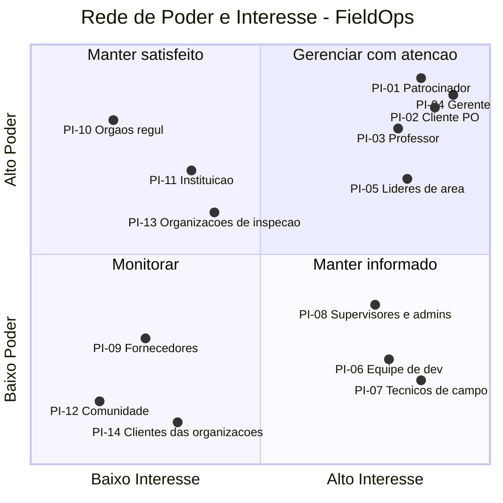

# Rede de Poder/Interesse — Partes Interessadas do Projeto FieldOps

> **Disciplina:** Gestão de Projetos — 4º semestre de ADS
> **Professor:** Me. Deivison S. Takatu
> **Aula 08:** Aquisições e Partes Interessadas — Atividade de Partes Interessadas
> **Projeto:** FieldOps — Plataforma de Inspeção em Campo
> **Equipe:** 404 Not Found
> **Data:** 23/10/2026

---

## 1. Objetivo

O presente artefato organiza a **Rede de Poder/Interesse do Projeto FieldOps**, construída a partir do processo de **Gerenciamento das Partes Interessadas** (área 13 do PMBOK), que compreende quatro etapas: identificar as partes interessadas, planejar seu gerenciamento, gerenciar o engajamento e, por fim, controlar esse engajamento.

A classificação de cada parte interessada combina duas dimensões: o **poder**, ou seja, a capacidade que ela tem de influenciar decisões e a alocação de recursos no projeto, e o **interesse**, entendido como o quanto ela se preocupa com os resultados obtidos. Cruzando essas duas dimensões, chega-se a quatro estratégias distintas de engajamento: **monitorar**, **manter informado**, **manter satisfeito** e **gerenciar com atenção**.

Para montar a análise, a equipe se apoiou nos artefatos de planejamento já produzidos ao longo do semestre — o TAP (onde estão listados os interessados), o organograma, o plano de comunicação, a matriz RACI e o registro de riscos do projeto.

---

## 2. Identificação das Partes Interessadas

Para garantir que cada parte interessada caiba em um único quadrante, poder e interesse são classificados apenas como **Alto** ou **Baixo**.

| # | Parte interessada | Tipo | Poder | Interesse | Quadrante | Principal expectativa |
|---|---|---|:--:|:--:|---|---|
| PI-01 | Fundação Toyota do Brasil (Patrocinador) | Externa | Alto | Alto | Gerenciar com atenção | Receber o retorno do investimento de R$ 204.000,00 e ter o MVP entregue no prazo previsto |
| PI-02 | Cliente / Product Owner | Externa | Alto | Alto | Gerenciar com atenção | Obter valor efetivo e garantir que o produto atenda aos requisitos de negócio |
| PI-03 | Professor / Orientador | Externa | Alto | Alto | Gerenciar com atenção | Acompanhar a evolução acadêmica, a qualidade e o cumprimento das entregas |
| PI-04 | Natália — Gerente de Projeto e Líder Mobile | Interna | Alto | Alto | Gerenciar com atenção | Manter o projeto dentro do prazo, do custo e do escopo, levando o MVP ao sucesso |
| PI-05 | Líderes de área (Marcela — Backend/Nuvem; Júlia — Web/Nuvem) | Interna | Alto | Alto | Gerenciar com atenção | Coordenar tecnicamente as frentes e garantir a integração entre elas |
| PI-06 | Equipe de desenvolvimento (Lucas, Andressa, Carol, Ian, Rodrigo, Felipe) | Interna | Baixo | Alto | Manter informado | Contar com tarefas claras, ter dúvidas resolvidas e concluir as entregas |
| PI-07 | Técnicos de campo (usuários do app) | Externa | Baixo | Alto | Manter informado | Dispor de um aplicativo funcional, confiável e com bom desempenho offline |
| PI-08 | Supervisores de inspeção e administradores (usuários do painel web) | Externa | Baixo | Alto | Manter informado | Ter um painel ágil para cadastrar, planejar, revisar e aprovar inspeções |
| PI-09 | Fornecedores de nuvem e serviços (AWS, Figma, Expo etc.) | Externa | Baixo | Baixo | Monitorar | Receber a contratação dos serviços e os pagamentos em dia |
| PI-10 | Órgãos regulamentadores | Externa | Alto | Baixo | Manter satisfeito | Ver atendida a conformidade legal e as normas de inspeção |
| PI-11 | Instituição de ensino (SENAI) | Externa | Alto | Baixo | Manter satisfeito | Preservar a reputação acadêmica e manter a aderência à metodologia PBL |
| PI-12 | Comunidade / demais colegas de turma | Externa | Baixo | Baixo | Monitorar | Acompanhar o projeto como referência |
| PI-13 | Organizações responsáveis pela execução das inspeções | Externa | Alto | Baixo | Manter satisfeito | Contar com uma plataforma que padronize as inspeções e dê rastreabilidade a elas |
| PI-14 | Clientes atendidos pelas organizações de inspeção | Externa | Baixo | Baixo | Monitorar | Obter resultados de inspeção confiáveis e disponibilizados mais rápido |

**Por que algumas classificações não são evidentes:**
- **PI-05 Líderes de área:** na Matriz RACI são eles quem aprovam as entregas das suas frentes, o que lhes confere poder alto.
- **PI-06 e PI-08:** um grupo fornece o resultado e o outro o utiliza, mas nenhum dos dois define prioridades ou recursos do projeto, daí o poder baixo.
- **PI-09 Fornecedores:** conforme o plano de aquisições, existem vários fornecedores alternativos para cada serviço, de modo que nenhum deles exerce poder alto sobre o projeto.
- **PI-11 Instituição de ensino:** é ela quem estabelece o calendário e as regras de avaliação (como a prorrogação da entrega para 24/11/2026), porém não acompanha o dia a dia — essa função cabe ao professor (PI-03).
- **PI-13 Organizações de inspeção:** são elas que decidem se vão adotar a plataforma, mas acompanham o projeto por intermédio do Cliente/PO (PI-02).

> A Natália aparece apenas em PI-04, pois esse item já concentra os papéis de Gerente de Projeto e Líder Mobile.

---

## 3. Matriz de Rede de Poder/Interesse

A matriz cruza o **poder** (eixo vertical) com o **interesse** (eixo horizontal), e cada quadrante aponta a estratégia de engajamento a ser adotada:

---

## 4. Estratégias de Engajamento por Quadrante

### 4.1 🔴 Gerenciar com atenção (Alto poder · Alto interesse)
> São as partes interessadas mais importantes e precisam estar plenamente engajadas e satisfeitas.

| Parte interessada | Estratégia de engajamento | Canal |
|---|---|---|
| PI-01 Patrocinador (Fundação Toyota) | Apresentar os resultados e alinhar investimento e prazo | Demonstração ao final de cada sprint, presencial ou no Meet |
| PI-02 Cliente / PO | Validar continuamente as entregas, priorizar o backlog e aprovar o MVP | Relatório de status por e-mail + demo de sprint (Meet) |
| PI-03 Professor / Orientador | Apresentar a evolução e as entregas acadêmicas | Reunião + repositório GitHub |
| PI-04 Gerente de Projeto (Natália) | Conduzir integralmente o projeto, coordenando frentes e cerimônias | Todos os canais |
| PI-05 Líderes de área (Marcela, Júlia) | Participar das decisões técnicas, aprovar as entregas da área e alinhar a integração | Coordenação técnica semanal (Meet/GitHub) + planejamento de sprint |

### 4.2 🟠 Manter satisfeito (Alto poder · Baixo interesse)
> Têm pouco interesse no dia a dia, mas alto poder — basta mantê-las satisfeitas, sem sobrecarregar com detalhes.

| Parte interessada | Estratégia de engajamento | Canal |
|---|---|---|
| PI-10 Órgãos regulamentadores | Garantir a conformidade legal e normativa das inspeções, acionando apenas quando necessário | Comunicação formal pontual |
| PI-11 Instituição de ensino (SENAI) | Cumprir o calendário e os critérios de avaliação, mantendo o repositório organizado para consulta | Entregas da disciplina + repositório |
| PI-13 Organizações de inspeção | Mostrar, por meio do Cliente/PO, como a plataforma atende ao processo de inspeção | Comunicado de entrega (e-mail) + demonstrações via Cliente/PO |

### 4.3 🟡 Manter informado (Baixo poder · Alto interesse)
> Muito interessadas, porém com baixo poder — convém mantê-las bem informadas e engajadas.

| Parte interessada | Estratégia de engajamento | Canal |
|---|---|---|
| PI-06 Equipe de desenvolvimento | Manter o backlog claro, realizar as dailies, tirar dúvidas e fazer revisão de código | WhatsApp + GitHub (Issues/PR) |
| PI-07 Técnicos de campo (usuários) | Colher feedback de usabilidade do app e do fluxo offline | Testes de campo + sessões de validação por sprint |
| PI-08 Supervisores e administradores | Obter feedback sobre o painel de cadastro, planejamento, revisão e aprovação | Sessões de validação por sprint + homologação |

### 4.4 🟢 Monitorar (Baixo poder · Baixo interesse)
> Basta acompanhar com esforço mínimo, sem uma comunicação intensa.

| Parte interessada | Estratégia de engajamento | Canal |
|---|---|---|
| PI-09 Fornecedores de serviços | Acompanhar contratos, SLA e pagamentos (ligado ao risco R02 e às aquisições) | Portais dos fornecedores |
| PI-12 Comunidade / colegas | Compartilhar os resultados ao final, sem comunicação dedicada | Repositório público |
| PI-14 Clientes das organizações | Informar a entrega por intermédio das organizações de inspeção | Comunicado de entrega (e-mail, via organizações) |

---

## 5. Técnica Analítica — Nível de Engajamento

A tabela a seguir classifica o engajamento **atual (C)** e o **desejado (D)** das principais partes interessadas, conforme a técnica analítica de partes interessadas, cujos níveis são: desinformado, resistente, neutro, dá apoio e lidera. Sempre que o nível atual já coincide com o desejado, a célula apresenta **C/D**.

| Parte interessada | Desinformado | Resistente | Neutro | Dá apoio | Lidera |
|---|:--:|:--:|:--:|:--:|:--:|
| PI-01 Patrocinador (Fundação Toyota) | | | | C | D |
| PI-02 Cliente / PO | | | C | D | |
| PI-03 Professor / Orientador | | | | C/D | |
| PI-04 Gerente (Natália) | | | | | C/D |
| PI-05 Líderes de área | | | | | C/D |
| PI-06 Equipe de desenvolvimento | | | | C/D | |
| PI-07 Técnicos de campo | C | | | D | |
| PI-08 Supervisores e administradores | C | | | D | |
| PI-11 Instituição de ensino | | | | C/D | |
| PI-13 Organizações de inspeção | C | | | D | |

> **Legenda:** **C** = engajamento atual · **D** = engajamento desejado. As lacunas (técnicos de campo, supervisores, administradores e organizações ainda desinformados) indicam onde agir — por meio de sessões de validação, testes de campo e do comunicado de entrega.

---

## 6. Considerações Finais

- Foram identificadas **14 partes interessadas**, contemplando todos os interessados registrados no TAP, e cada uma foi posicionada na **Rede de Poder/Interesse**, resultando em quatro estratégias de engajamento.
- No quadrante **"Gerenciar com atenção"** ficaram concentrados Patrocinador, Cliente/PO, Professor, Gerente de Projeto e Líderes de área — os atores com maior poder e interesse no projeto.
- A matriz está **alinhada ao plano de comunicação do projeto**: cada estratégia reaproveita os canais e as frequências ali definidos (demonstração ao patrocinador ao final de cada sprint, relatório de status e demo de sprint ao Cliente/PO, sessões de validação com os usuários, coordenação técnica semanal e comunicado de entrega).
- O engajamento dos **fornecedores** conecta-se de forma direta ao **gerenciamento das aquisições** e ao risco **R02 (indisponibilidade dos serviços de nuvem de terceiros)** do registro de riscos do projeto.
- Este artefato deve ser **monitorado no processo 13.4 — Controlar o engajamento das partes interessadas**, com ajustes na classificação e nas estratégias conforme o projeto evolui.
